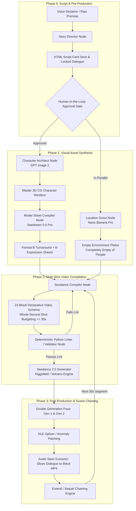
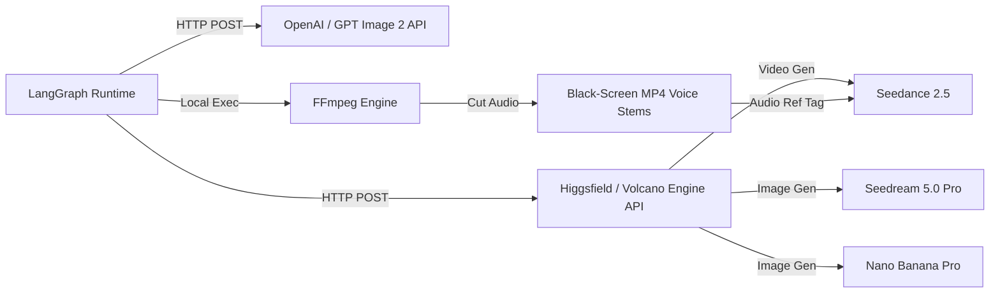

# MASTER SPECIFICATION & HANDOFF DOCUMENT: SEEDANCE 2.5 PIXAR-GRADE AI ANIMATION HARNESS

> **DOCUMENT CLASSIFICATION:** Turnkey Architecture Specification & Implementation Blueprint  
> **TARGET AUDIENCE:** Claude / Autonomous Agent / Lead Systems Engineer (One-Shot Production Handoff)  
> **CORE OBJECTIVE:** Build a deterministic, production-grade LangGraph Deep Agent pipeline that replicates Dan Kieft's Pixar-level multi-shot AI animation workflow (Seedance 2.5, GPT Image 2, Seedream 5.0 Pro, Nano Banana Pro).

---

# TABLE OF CONTENTS / SLIDE OVERVIEW

- **SLIDE 1: Executive Architectural Blueprint & System Topology**
- **SLIDE 2: Skill Files Strategy — Shared Architecture vs. Modular Role Overlays**
- **SLIDE 3: The Complete Agent Skill Files (Verbatim Dan Kieft Core Engine)**
- **SLIDE 4: Mathematical Engineering & Hard Constraints**
- **SLIDE 5: Prompt Engineering Mastery & Defensive Guardrails**
- **SLIDE 6: Production Prompts Library (Verbatim Gold Standards)**
- **SLIDE 7: Complete LangGraph Deep Agents Python Implementation**
- **SLIDE 8: APIs, Tooling, & Post-Production Audio/Video Automation**
- **SLIDE 9: One-Shot Copy-Paste Handoff Prompt for Claude**

---

<!-- SLIDE 1 -->
# SLIDE 1: Executive Architectural Blueprint & System Topology

### 1.1 The Breakthrough Insight: Why Traditional AI Video Pipelines Fail
Most generative video workflows fail because users feed shallow, single-sentence text prompts directly into video models (`"cute 3D pixar girl in a classroom"`). The video model is forced to simultaneously hallucinate anatomy, facial geometry, spatial staging, lighting, camera physics, lip-sync, and continuity. The result is generic, rubbery "AI slop" with drifting identities, morphing clothing, and flickering environments.

Dan Kieft’s workflow succeeds by enforcing an **uncompromising, staged pre-production and generation pipeline**:



### 1.2 Pipeline Component Matrix

| Stage | Responsibility | Primary Engine / Tool | Critical Output Contract |
| :--- | :--- | :--- | :--- |
| **0. Story & Script** | Dramatic structure, Rule of Three, verbatim dialogue lock | Claude + Voice Dictation | `SegmentScript` with whole-second time budgets ($\le 30$s) |
| **1. Master Character** | Anatomical proportions, silhouette, skin zoning | GPT Image 2 | Neutral studio render, 50mm, `#B5B5B5` grey backdrop |
| **2. Model Sheet** | 3D multi-angle & facial expression anchors | Seedream 5.0 Pro (2K) | Format B: 4 turnarounds + 8 standardized expressions |
| **3. Location Plate** | Spatial geometry, staging coordinates, lighting key | Nano Banana Pro (16:9) | Clean room plate, **completely empty of people**, max 1 sign |
| **4. Video Compilation**| Multi-shot direction, motion physics, camera fences | Seedance 2.5 (1080p DiT) | 10-block schema payload, named `@elements`, `{dialogue}` |
| **5. Continuity Extend**| Voice timbre persistence, infinite scene chaining | FFmpeg + Extend (Sequel) | `<30s` Black-screen MP4 voice references |

---

<!-- SLIDE 2 -->
# SLIDE 2: Skill Files Strategy — Shared Architecture vs. Modular Role Overlays

### 2.1 The Architectural Trade-Off Analysis

When deploying deep agents in LangGraph, developers frequently debate two extremes:
1. **The Monolithic Approach (Single Shared Skill File)**: Passing one massive 1,000-line Markdown document to every LLM node and appending `"You are Node X, execute Task Y"`.
2. **The Hyper-Fragmented Approach (Isolated Micro-Skills)**: Writing tiny, completely isolated 50-line prompts for each agent.

Both extremes fail in production:
* *Why Monolithic Fails*: The LLM suffers from context dilution. When the `LocationScout` reads 400 lines about child facial anatomy, teeth gaps, and turnaround turn angles, it hallucinates character features into empty room plates.
* *Why Hyper-Fragmented Fails*: Cross-pipeline contracts break. The `SeedanceCompiler` doesn't know *why* the character has a single saturated red watch, or *why* the dialogue was budgeted to 2 seconds, leading to contradictory outputs.

### 2.2 The Winning Pattern: The "Shared Engine Core + Specialized Role Overlays"

We implement a **Two-Tier Layered Skill Architecture**:
* **Tier 1: `PIXAR_CORE_ENGINE.md` (Shared Contract)**:
  Contains immutable global constants:
  * House Style Definition (Production CG 3D, stylised feature-animation, not photorealistic, not flat cartoon).
  * Neutral Backdrop Lock (`#B5B5B5` mid-grey).
  * The 30-Second Hard Ceiling rule.
  * The Single Saturated Accent Rule.
  * The "No Commentary / No Fragment" Law.
* **Tier 2: Specialized Role Skill Files (Overlays)**:
  Dedicated, razor-sharp instruction cards injected specifically into the corresponding node:
  1. `skill_story_director.md`
  2. `skill_character_architect.md`
  3. `skill_model_sheet_compiler.md`
  4. `skill_location_scout.md`
  5. `skill_seedance_video_compiler.md`
  6. `skill_continuity_supervisor.md`

---

<!-- SLIDE 3 -->
# SLIDE 3: The Complete Agent Skill Files (Verbatim Dan Kieft Engine)

### 3.1 Tier 1: Shared Core Engine (`core_engine.md`)

```markdown
# PIXAR ANIMATION PRODUCTION PIPELINE — CORE ENGINE RULES

House Style Throughout: Stylised feature-animation 3D. Production CG, not photorealistic, not flat cartoon.

NON-NEGOTIABLE CORE LAWS:
1. 30 SECONDS IS A HARD CEILING: Never write a segment longer than 30 seconds. All shot durations must be whole integers (no halves, no decimals) summing to <= 30s.
2. ONE BLOCK EQUALS ONE SHOT: In video compilation, a new block is interpreted by the model as a camera cut. If a camera move is continuous, it must remain in ONE block.
3. OUTPUT IN FULL ALWAYS: Never output prompt fragments, partial blocks, or "same as above except". Every generation payload must be copy-paste complete.
4. ONE SATURATED ACCENT: Characters and sets must maintain a muted, warm palette with exactly ONE saturated color accent that carries story and identification.
5. NO LIVE-ACTION JARGON: Banned tokens: 35mm, Kodak, film stock, photoreal, pore detail, grain, camera 25 meters away, paparazzi feel. Replace with: production CG, feature-quality 3D animation, subsurface glow, cloth with weight.
```

### 3.2 Tier 2: Role Skill — Story Director (`skill_story_director.md`)

```markdown
# ROLE: STORY DIRECTOR & DIALOGUE LOCKER

You are the Story Director. Your job is not to transcribe ideas; it is to direct them into executable animation structure.

DIRECTING PRINCIPLES:
1. ORDINARY WORLD CONTRAST: Comedy and reveals run on contrast. Keep the baseline world ordinary so the subversion lands.
2. RULE OF THREE: Two straight setups establish the pattern; the third breaks it. Never have four or five presentations.
3. ESCALATING GAG LADDER: A repeating element must visibly escalate across stages (e.g. hand writing -> hand clamped -> hand shooting up -> body bobbing).
4. BUSINESS BEATS DIALOGUE: Hands engaged in a physical task (scrubbing a crayon drawing) tell more story than lines about being eager. The strongest beat is stopping the business dead.
5. REACTION OVER ACTION: Cut to the reaction of the listener.

DIALOGUE LOCKING RULES:
- Every line of dialogue must be locked verbatim before shot planning begins.
- Young child vernacular: flat declarative facts, total conviction, "not even", small details weighted equally with big ones, sentences started and abandoned.
- Timing budget: Short line = 2s; Two-line exchange = 4s; Silent beat = 2-3s.
- Formatted output: Segment cards with verbatim dialogue enclosed in braces {}.
```

### 3.3 Tier 2: Role Skill — Character Architect (`skill_character_architect.md`)

```markdown
# ROLE: CHARACTER ARCHITECT (MASTER RENDERS)

You author single-character full-body master render prompts for GPT Image 2.

PROPORTIONS BY HEAD HEIGHT:
- Toddler: 4 heads tall
- Child (6–10): 5 heads tall (long torso, short legs, low center of gravity, enlarged head, narrow shoulders)
- Teen: 6–6.5 heads tall
- Adult: 7 heads tall (NEVER apply the child proportion rider to adults; avoids bobbleheads)

ANATOMY & EXAGGERATION RULES:
- One Exaggeration + Counterpart: Push one feature well past life size and push its neighbors the opposite way (e.g., large eyes against small mouth and narrow jaw). Stating only the exaggeration causes model regression.
- Hands: Oversized relative to body, built from a few large rounded forms, thick blunt fingertips, minimal knuckles, soft palms.
- Facial Hair: A soft matte shell/tint over the skin, NOT individual drawn strands.
- Skin Zoning:
  * Light Skin: pink nose tip, translucent red ear tips, flushed cheeks, cool purple-grey under eyes.
  * Deep Skin: deep red-orange at nose and ear rims, plum-red flush across cheeks, cool grey-violet under eyes (prevents ashen/grey tones).
- Signature Element: Must be WORN or ATTACHED (pinned, tied, buttoned). NEVER a held object.
- Stance: Neutral reference pose, weight on one leg, 50mm lens at chest height, empty hands at sides, empty flat mid-grey backdrop #B5B5B5.
```

### 3.4 Tier 2: Role Skill — Model Sheet Compiler (`skill_model_sheet_compiler.md`)

```markdown
# ROLE: MODEL SHEET COMPILER (FORMAT B TURNAROUND & EXPRESSIONS)

You take approved master character renders and generate Format B 12-Panel Character Sheets for Seedream 5.0 Pro (2K).

FORMAT B ARCHITECTURE:
- Canvas: Flat mid-grey backdrop #B5B5B5 across the entire canvas (lock with hex code).
- TOP ROW (Turnaround): 4 full-body views in identical neutral stance, aligned to the exact same baseline:
  1) Front view facing camera
  2) Three-quarter front view turned slightly left
  3) Full side profile facing left
  4) Back view
- BELOW (Expression Set): 8 head-and-shoulders close-ups in two even rows of four:
  1) NEUTRAL: face relaxed, mouth closed, eyes level.
  2) HAPPY: warm closed-lip smile, eyes softly crinkled.
  3) DELIGHTED: eyes wide and bright, unguarded grin showing teeth/gap.
  4) SAD: inner brows lifted, mouth turned down, eyes wet and lowered.
  5) SURPRISED: eyes wide, brows high, small round mouth.
  6) CONFUSED: asymmetrical brows (one up, one down), mouth pushed to side.
  7) ANGRY: brows low and drawn together, firm mouth line, chin tucked.
  8) TALKING: caught mid-word, mouth open in speech, eyes engaged.

CRITICAL FAILURE PREVENTIONS:
- Identity text must describe the actual render, not the initial design prompt.
- Clean skin enforcement: Add "Her arms, wrists and hands are completely clean and unmarked — no ink, no tattoos, no markings of any kind."
```

### 3.5 Tier 2: Role Skill — Location Scout (`skill_location_scout.md`)

```markdown
# ROLE: LOCATION SCOUT (ENVIRONMENT PLATES)

You generate empty background plates for Nano Banana Pro (16:9).

LOCATION CONTRACTS:
1. COMPLETELY EMPTY OF PEOPLE: Mandatory verbatim inclusion. Background figures cause video models to hallucinate duplicates and mutant limbs.
2. MATCH SCRIPT STAGING: Position the camera at the exact height, angle, and perspective required by the script's blocking.
3. PALETTE DISCIPLINE: Keep sets muted and warm. If a prop or character carries a saturated signature accent, forbid that color from the room walls.
4. TEXT RESTRICTIONS: Maximum ONE hand-lettered paper sign (e.g. drooping banner reading "MY FAMILY"). Forbid all other signs, posters, and alphabet strips to prevent mangled AI runes.
5. LIGHTING ANCHOR: Define the primary key light direction explicitly (e.g. "warm morning sunlight streaming from unseen windows on the left casting long gentle shadows").
```

### 3.6 Tier 2: Role Skill — Seedance Video Compiler (`skill_seedance_video_compiler.md`)

```markdown
# ROLE: SEEDANCE 2.5 VIDEO COMPILER

You compile 30-second multi-shot video prompts for Seedance 2.5 following the official 10-block schema.

THE 10-BLOCK SCHEMA:
1. [REFERENCE MATERIALS]: Bind only actual uploaded elements using real platform handles (@Mia, @Ben, @classroom). No @image1 slot names.
2. [VOICES]: One verbatim voice block per speaker, reused identically across all segments.
3. [GOAL]: 2-3 sentences stating shot count, total runtime (<=30s), and the hard narrative stop ("It ends the instant X finishes — do not continue, do not resolve anything, do not add an ending").
4. [CONTINUITY]: Character counts, seating/standing coordinates, prop state, and the 180-degree camera axis lock.
5. [SHOTS]: Sequential shot blocks (SHOT 1 | 0-3s ... Hard cut. SHOT 2 | 3-5s). Dialogue inline on its own line: @Speaker: {verbatim line}.
6. [VISUAL STYLE]: Production CG, subsurface glow, warm daylight, depth of field as in-camera artifact. No live-action tokens.
7. [CAMERA AND PERFORMANCE]: Shot and cut count verification. Objective-based acting paragraphs. Animation physics:
   - Anticipation (movement winds opposite way first)
   - Snap and settle (fast between poses with overshoot arrival)
   - Moving holds (held poses breathe and micro-shift; never frozen)
   - Overlap/Secondary motion (hair and cloth arrive a beat late)
   - Eye life mandatory (micro-saccades, catchlights, blink rate)
   - Body broad, face honest (no mugging)
8. [AUDIO]: Foley, room tone, score cues. NO DIALOGUE TEXT HERE.
9. [EXCLUSIONS]: "The only spoken words in the entire segment are the lines in braces. No extra cuts anywhere. No unison movement."
10. [MAINTAIN CONSISTENCY]: Explicit character/prop counts and height relationships.
```

---

<!-- SLIDE 4 -->
# SLIDE 4: Mathematical Engineering & Hard Constraints

### 4.1 Timecode Arithmetic & Pacing Calculus

A Seedance 2.5 segment is mathematically constrained by:

$$\text{Total Runtime} = \sum_{i=1}^{N} \Delta t_i \le 30 \quad (\text{where } \Delta t_i \in \mathbb{Z}^+)$$

Every shot duration $\Delta t_i$ must be an **integer** (whole second). Halves and decimals ($2.5\text{s}$) are strictly illegal because diffusion temporal attention models quantize cuts to integer frame cadences.

#### Shot Duration Budgeting Table:
$$\begin{array}{|l|c|l|}
\hline
\textbf{Beat Type} & \textbf{Standard Budget} & \textbf{Mathematical Rationale} \\ \hline
\text{Reaction / Cutaway} & 2\text{ seconds} & \text{Minimum duration for facial expression to register} \\ \hline
\text{Single Short Line} & 2\text{ seconds} & 3\text{ to }5\text{ spoken words at }150\text{ wpm} + 0.5\text{s tail} \\ \hline
\text{Two-Line Exchange} & 4\text{ seconds} & \text{Speaker A }(1.5\text{s}) + \text{Turn-turn beat }(0.5\text{s}) + \text{Speaker B }(2\text{s}) \\ \hline
\text{Staged Continuous Pan} & 5\text{ seconds} & \text{Pan right }(2\text{s}) + \text{Hold/Bobbing }(1.5\text{s}) + \text{Pan left }(1.5\text{s}) \\ \hline
\text{Dramatic Climax / Reveal} & 3\text{ to }4\text{ seconds} & \text{Camera rise/push-in with closing line} \\ \hline
\end{array}$$

### 4.2 Anatomical Proportion Geometry (The Head Height Ratio)

$$\text{Head Ratio} = \frac{\text{Total Height}}{\text{Cranium Height}}$$

* **Toddler**: $4.0\text{ heads}$ (Cranium constitutes $25\%$ of total vertical height).
* **Child (Age 5–8)**: $4.5\text{ to }5.0\text{ heads}$ ($20\%$ vertical height).
  * Child Torso Ratio: $\text{Torso} \approx 1.4 \times \text{Leg Length}$ (Low center of gravity).
* **Teen**: $6.0\text{ to }6.5\text{ heads}$.
* **Adult**: $7.0\text{ heads}$ ($14.3\%$ vertical height).
  * Adult Torso Ratio: $\text{Leg Length} \approx 1.2 \times \text{Torso Length}$.

$$\text{Regression Risk Mitigation Vector: } \vec{V}_{\text{exaggeration}} = - \sum \vec{V}_{\text{neighbors}}$$
*To prevent diffusion averaging, if eye diameter is scaled $+50\%$, mouth width and jaw radius must be scaled $-30\%$.*

### 4.3 Spatial 180-Degree Fencing Vector

The camera coordinate $C(x, y)$ relative to the line of action between characters $A(x_1, y_1)$ and $B(x_2, y_2)$ is mathematically restricted to a single half-plane:

$$\text{Line of Action: } L(x, y) = (y_2 - y_1)x - (x_2 - x_1)y + (x_2 y_1 - y_2 x_1) = 0$$
$$\text{Fencing Constraint: } \operatorname{sgn}(L(C_x, C_y)) = \text{constant for all } t \in [0, 30]$$
*Crossing this axis causes background geometry and character screen-side positions to invert across cuts.*

---

<!-- SLIDE 5 -->
# SLIDE 5: Prompt Engineering Mastery & Defensive Guardrails

### 5.1 The 1-Block = 1-Cut Law
Seedance 2.5 parses paragraph returns in `[SHOTS]` as camera cut triggers. 
* If a camera move is meant to pan across two characters, **never split them into two blocks**. Write the entire movement in one single block with the command: *"One continuous move — the camera never stops and never cuts."*
* Conversely, every hard cut requires a dedicated block ending with `Hard cut.`

### 5.2 Anti-Mugging Acting Enforcement
In `[CAMERA AND PERFORMANCE]`:
* **Bad Prompt**: `"Mia looks super funny, crazy, and excited."` $\rightarrow$ Model produces rubbery, distorted, grotesque grimaces.
* **Master Prompt**: `"The body plays broad. The face stays honest. No mugging, no pulled faces, no comic reactions. Business is the crayon and paper, and the strongest accent is stopping that business dead."`

### 5.3 Staggered Ensemble Reaction (Anti-Unison)
Diffusion models default to synchronizing crowds. 
* **Defense**: Explicitly declare asynchronous arrival:
  > *"The class applauds, the reaction travelling raggedly around the ring rather than starting together, some children late to it... The other seven children react as individuals, staggered, never together, each doing something different. Never a unison movement and never a unison sound."*

### 5.4 Narrative Clamping in `[GOAL]`
Diffusion models attempt to resolve narrative tension with unscripted camera fades.
* **Defense**: Declare the narrative boundary:
  > *"It ends the instant the shy child's first line finishes — do not continue into her story, do not resolve anything, do not add an ending."*

---

<!-- SLIDE 6 -->
# SLIDE 6: Production Prompts Library (Verbatim Dan Kieft Stash)

*(Refer to `05_PRODUCTION_REFERENCE_PROMPTS.md` for full verbatim copies of Firefighter Dad, Mia Turnaround Sheet, Empty Classroom Plate, and the 27-second Sequel Video Prompt).*

---

<!-- SLIDE 7 -->
# SLIDE 7: Complete LangGraph Deep Agents Python Implementation

*(Refer to `01_LANGGRAPH_DEEPAGENTS_SETUP.py` for the complete executable codebase featuring typed Pydantic models, LangGraph StateGraph, deterministic linter, and human approval gates).*

---

<!-- SLIDE 8 -->
# SLIDE 8: APIs, Tooling, & Post-Production Audio/Video Automation

### 8.1 API Integration Matrix



1. **Seedance 2.5 Video Generation**:
   * **Endpoint**: `https://api.higgsfield.ai/v1/video/seedance-2-5` (or ByteDance Volcano Engine Ark API).
   * **Payload Parameters**:
     * `model`: `"seedance-2.5"`
     * `mode`: `"extend"` (direction: `"sequel"` or `"prequel"`)
     * `duration`: `29` (seconds)
     * `resolution`: `"1080p"`
     * `aspect_ratio`: `"16:9"`
     * `elements`: `[{"tag": "@Mia", "file_id": "..."}, ...]`
     * `prompt`: `<10-block compiled string>`

2. **Image Generation**:
   * Master Characters: **GPT Image 2** (via OpenAI API or Higgsfield).
   * Model Sheets: **Seedream 5.0 Pro** at 2K resolution.
   * Location Plates: **Nano Banana Pro** at 5356 × 3072.

### 8.2 Automated Audio Stem Extractor (`audio_stem_extractor.py`)

This script extracts clean character dialogue from Gen 1 and generates the `<30s` black-screen MP4 required to lock voice timbre:

```python
import subprocess
import os

def generate_black_screen_voice_ref(
    input_video_path: str,
    dialogue_timestamps: list[tuple[float, float]],
    output_stem_path: str
):
    """
    Extracts dialogue segments, stitches them, and exports an MP4 with black video.
    Seedance requires an MP4 container (not MP3) to ingest voice references.
    """
    # 1. Build FFmpeg filter select expression
    select_filters = " + ".join([
        f"between(t,{start},{end})" for start, end in dialogue_timestamps
    ])
    
    # 2. Run FFmpeg command: Black video source + filtered audio
    cmd = [
        "ffmpeg", "-y",
        "-f", "lavfi", "-i", "color=c=black:s=640x360:r=30",
        "-i", input_video_path,
        "-filter_complex", f"[1:a]aselect='{select_filters}',asetpts=N/SR/TB[outa]",
        "-map", "0:v", "-map", "[outa]",
        "-c:v", "libx264", "-tune", "stillimage", "-pix_fmt", "yuv420p",
        "-c:a", "aac", "-b:a", "192k",
        "-shortest",
        output_stem_path
    ]
    subprocess.run(cmd, check=True)
    print(f"Generated voice reference stem: {output_stem_path}")
```

---

<!-- SLIDE 9 -->
# SLIDE 9: One-Shot Copy-Paste Handoff Prompt for Claude

*(Copy this prompt into Claude tomorrow to generate the entire repository in one shot):*

```text
You are Antigravity Senior Systems Architect. Build out the complete, production-grade Pixar AI Animation Pipeline using LangGraph and Python.

You have full access to:
1. The 10-Block Seedance 2.5 Video Schema.
2. The Format B 12-Panel Character Model Sheet architecture (4 turnaround views + 8 standard expressions on #B5B5B5).
3. The Empty Location Plate generator (completely empty of people, directional key light).
4. The Deterministic Python Linter for 30s ceiling, whole-second integer budgets, and brace dialogue locks.
5. The FFmpeg Black-screen MP4 voice extraction loop.

Requirements:
- Scaffold the LangGraph state machine using StateGraph and Pydantic.
- Implement the 5 deep agent nodes (StoryDirector, CharacterArchitect, ModelSheetCompiler, LocationScout, SeedanceCompiler).
- Implement the deterministic mathematical linting node.
- Include human-in-the-loop approval after the script stage.
- Do NOT use an LLM orchestrator; rely on LangGraph's native deterministic code routing.
- Implement the FFmpeg audio stem extraction utility.

Proceed to generate the complete, runnable Python project structure now.
```
